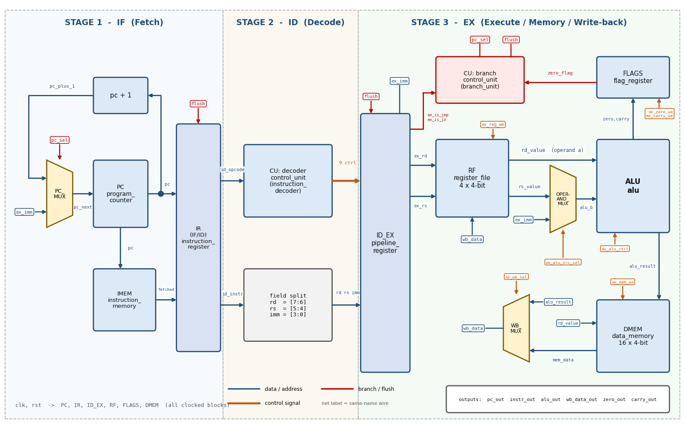
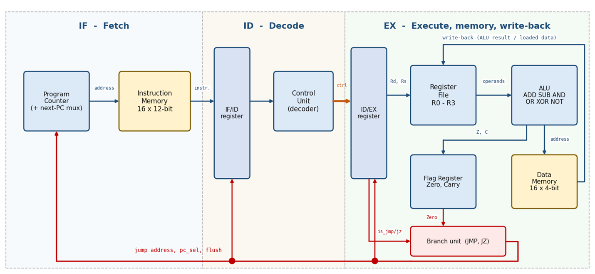
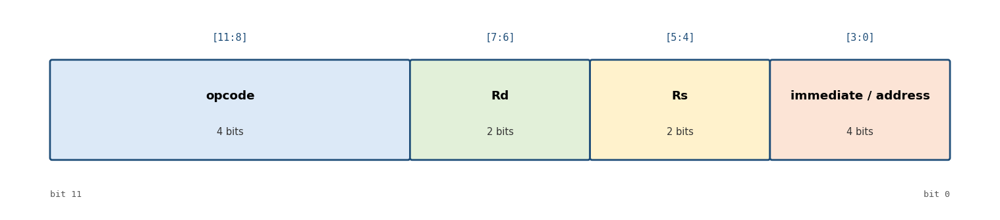
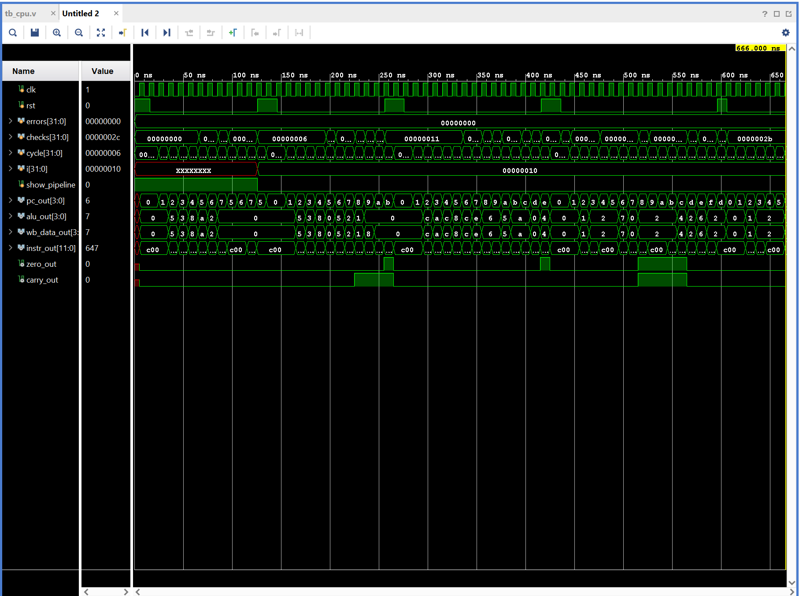

# 4-bit 3-Stage Pipelined RISC CPU (Verilog HDL)


RTL design and verification of a **4-bit, 3-stage pipelined RISC CPU** with a **Harvard architecture** and a **12-bit instruction word**, written in Verilog HDL, simulated with self-checking testbenches, and synthesized for a Xilinx Kintex-7 FPGA in Vivado.



---

## Table of Contents

1. [Overview](#1-overview)
2. [Key Features](#2-key-features)
3. [Architecture](#3-architecture)
4. [Instruction Set Architecture (ISA)](#4-instruction-set-architecture-isa)
5. [Pipeline Operation](#5-pipeline-operation)
6. [Hazard Handling](#6-hazard-handling)
7. [Repository Structure](#7-repository-structure)
8. [Module Descriptions](#8-module-descriptions)
9. [Control Signals](#9-control-signals)
10. [Getting Started](#10-getting-started)
11. [Test Programs](#11-test-programs)
12. [Verification](#12-verification)
13. [Results](#13-results)
14. [Limitations and Future Work](#14-limitations-and-future-work)
15. [Tools and Environment](#15-tools-and-environment)
16. [License](#16-license)

---

## 1. Overview

This project is a small educational processor built from scratch in Verilog. It demonstrates the core ideas of a modern CPU in a compact form:

- A **4-bit datapath**: registers, ALU and data-memory words are all 4 bits wide.
- A **12-bit instruction word** stored in a separate instruction memory.
- A **3-stage pipeline** (Fetch, Decode, Execute) that overlaps three instructions at once, so one instruction completes every clock cycle once the pipeline is full.
- A **Harvard architecture**: instruction memory and data memory are separate, so an instruction fetch and a `LOAD`/`STORE` can happen in the same cycle.
- **Hardwired control** with a branch unit that resolves jumps in the Execute stage and flushes the pipeline when a jump is taken.

The design is modular (11 source files), fully documented in-line, and verified by four self-checking testbenches (88 checks in total).

A detailed design report (diagrams, truth tables, waveforms and the Vivado flow) is available in [`doc/CPU_4bit_Datapath_Report.pdf`](doc/CPU_4bit_Datapath_Report.pdf).

**Quick start** (requires [Icarus Verilog](https://steveicarus.github.io/iverilog/)):

```bash
cd programs
iverilog -g2005 -o ../tb_cpu.vvp ../rtl/*.v ../testbench/tb_cpu.v
vvp ../tb_cpu.vvp          # prints "tb_cpu PASSED: 44 of 44 checks OK"
```

## 2. Key Features

| Feature | Description |
|---|---|
| Datapath width | 4 bits |
| Instruction width | 12 bits: `opcode[11:8]`, `Rd[7:6]`, `Rs[5:4]`, `immediate/address[3:0]` |
| Instructions | 12 (ADD, SUB, AND, OR, XOR, NOT, LDI, MOV, LOAD, STORE, JMP, JZ); opcodes `1100`–`1111` are reserved and behave as NOP |
| Architecture | Harvard (separate instruction and data memories) |
| Pipeline | 3 stages: IF (Fetch), ID (Decode), EX (Execute / Memory / Write-back) |
| Registers | 4 general-purpose registers `R0`–`R3` (4 bits each), 2 read ports, 1 write port |
| Flags | Zero (`Z`) and Carry (`C`), with separate update enables |
| Instruction memory | 16 words x 12 bits (ROM, loaded from a `.mem` file) |
| Data memory | 16 words x 4 bits (RAM) |
| Throughput | 1 instruction per clock cycle (ideal CPI = 1) |
| Data hazards | None: no stall and no forwarding needed (see [Section 6](#6-hazard-handling)) |
| Jump penalty | 2 clock cycles (the two younger instructions are flushed) |
| Verification | 4 self-checking testbenches, 88 checks, all passing |

## 3. Architecture

### 3.1 Block Diagram



### 3.2 Pipeline Stages

| Stage | Name | What happens |
|---|---|---|
| 1 | **IF: Fetch** | The program counter (PC) addresses the instruction memory. The fetched instruction is stored in the **IF/ID register**. The next PC is `PC + 1`, or the jump address when a jump is taken in EX. |
| 2 | **ID: Decode** | The control unit decodes the 4-bit opcode into control signals. The control signals and the instruction fields (`Rd`, `Rs`, `imm`) are stored in the **ID/EX register**. |
| 3 | **EX: Execute** | The register file is read, the operand MUX selects `Rs` or the immediate, the ALU computes, the data memory is accessed (`LOAD`/`STORE`), the result is written back to `Rd`, the flags are updated, and the branch unit decides whether to jump. |

### 3.3 Harvard Architecture

Instructions and data live in two separate memories with independent address paths. The Fetch stage reads the instruction memory while the Execute stage may access the data memory in the same cycle, so there is no structural hazard.

### 3.4 Data Flow at a Glance

```
 IF                      ID                       EX
 PC -> IMEM -> [IF/ID] -> Decoder -> [ID/EX] -> RF -> ALU -> DMEM -> WB MUX -> RF (write Rd)
 ^                                                 |
 |                                               FLAGS (Z, C)
 +---- jump address, pc_sel, flush <---- Branch unit (EX) <-- Zero flag
```

`[IF/ID]` and `[ID/EX]` are the two pipeline registers. The red path in the block diagram above (jump address, `pc_sel`, `flush`) is the only signal that travels backwards in the pipeline.

## 4. Instruction Set Architecture (ISA)

### 4.1 Instruction Format



| Bits | Field | Meaning |
|---|---|---|
| `[11:8]` | opcode | Selects the operation |
| `[7:6]` | Rd | Destination register (and first source operand) |
| `[5:4]` | Rs | Second source register |
| `[3:0]` | imm / addr | 4-bit immediate (`LDI`), data-memory address (`LOAD`/`STORE`), or jump address (`JMP`/`JZ`) |

Register numbers: `R0 = 00`, `R1 = 01`, `R2 = 10`, `R3 = 11`.

**Encoding example:** `LDI R1,5` is `0110 | 01 | 00 | 0101` = `0x645`.

### 4.2 Instruction Table

| Opcode | Mnemonic | Operation | Flags updated |
|---|---|---|---|
| `0000` | `ADD Rd,Rs` | `Rd <- Rd + Rs` | Z, C |
| `0001` | `SUB Rd,Rs` | `Rd <- Rd - Rs` | Z, C |
| `0010` | `AND Rd,Rs` | `Rd <- Rd AND Rs` | Z |
| `0011` | `OR Rd,Rs` | `Rd <- Rd OR Rs` | Z |
| `0100` | `XOR Rd,Rs` | `Rd <- Rd XOR Rs` | Z |
| `0101` | `NOT Rd` | `Rd <- NOT Rd` | Z |
| `0110` | `LDI Rd,imm` | `Rd <- imm` | none |
| `0111` | `MOV Rd,Rs` | `Rd <- Rs` | none |
| `1000` | `LOAD Rd,addr` | `Rd <- DMEM[addr]` | none |
| `1001` | `STORE Rd,addr` | `DMEM[addr] <- Rd` | none |
| `1010` | `JMP addr` | `PC <- addr` | none |
| `1011` | `JZ addr` | `if Z = 1 then PC <- addr` | none |
| `1100`–`1111` | reserved | NOP (does nothing) | none |

### 4.3 Flag Conventions

| Operation | Carry (`C`) | Zero (`Z`) |
|---|---|---|
| `ADD` | `1` when the sum is greater than 15 (carry-out) | `1` when the result is `0000` |
| `SUB` | `1` when `Rd >= Rs` (**no borrow**), `0` when a borrow occurred | `1` when the result is `0000` |
| `AND`, `OR`, `XOR`, `NOT` | not changed | `1` when the result is `0000` |
| `LDI`, `MOV`, `LOAD`, `STORE`, `JMP`, `JZ` | not changed | not changed |

`JZ` tests the **saved** Zero flag, i.e. the result of the most recent `ADD`/`SUB`/`AND`/`OR`/`XOR`/`NOT`.

### 4.4 Registers and Memories

| Item | Size | Notes |
|---|---|---|
| PC | 4 bits | Fetch address 0 to 15; wraps from 15 to 0; cleared to 0 on reset |
| `R0`–`R3` | 4 bits each | Cleared on reset |
| Flags `Z`, `C` | 1 bit each | Cleared on reset |
| Instruction memory | 16 x 12 bits | Unused words are filled with `C00` (NOP) |
| Data memory | 16 x 4 bits | Cleared to 0 at start-up; separate address space from instructions |

## 5. Pipeline Operation

### 5.1 Ideal Timing

Once the pipeline is full, one instruction completes per clock cycle.

```
Cycle:      1    2    3    4    5
Instr 1:    IF   ID   EX
Instr 2:         IF   ID   EX
Instr 3:              IF   ID   EX
Instr 4:                   IF   ID   EX
```

For straight-line code (no taken jump), N instructions finish after **N + 2** clock cycles (the 2 extra cycles are the pipeline fill latency). Each taken jump adds 2 more cycles.

### 5.2 Real Trace (from the testbench)

The table below is taken from the cycle-by-cycle trace printed by `tb_cpu` while running `program.mem`. Note the **flush** after `JMP 5` reaches the Execute stage in cycle 8.

| Cycle | IF (fetch addr) | ID | EX |
|---|---|---|---|
| 1 | 0 | bubble | bubble |
| 2 | 1 | `645` LDI R1,5 | bubble |
| 3 | 2 | `683` LDI R2,3 | `645` LDI R1,5 |
| 4 | 3 | `060` ADD R1,R2 | `683` LDI R2,3 |
| 5 | 4 | `6CA` LDI R3,10 | `060` ADD R1,R2 |
| 6 | 5 | `470` XOR R1,R3 | `6CA` LDI R3,10 |
| 7 | 6 | `A05` JMP 5 | `470` XOR R1,R3 |
| 8 | 7 | `C00` (wrong path) | `A05` JMP 5 **(jump taken, flush)** |
| 9 | 5 | bubble | bubble |
| 10 | 6 | `A05` JMP 5 | bubble |
| 11 | 7 | `C00` | `A05` JMP 5 |

### 5.3 How a Jump Works

1. `JMP` or `JZ` travels down the pipeline and reaches EX.
2. The branch unit sets `pc_sel = is_jmp OR (is_jz AND Zero)`.
3. When `pc_sel = 1`, the PC loads the jump address and `flush` empties the IF/ID and ID/EX registers (they become **bubbles**, i.e. NOPs that change nothing).
4. The two younger instructions that were already fetched are discarded, so a taken jump costs **2 cycles**.

## 6. Hazard Handling

| Hazard | Cause | Solution in this design |
|---|---|---|
| **Structural** | Instruction fetch and `LOAD`/`STORE` need memory in the same cycle | Separate instruction and data memories (Harvard architecture) |
| **Data (RAW)** | An instruction needs the result of the previous one | Registers are read **and** written in the same stage (EX). The result is written at the clock edge, and the next instruction reads after that edge, so **no stall and no forwarding** is needed. This also covers `LOAD` followed by a dependent instruction, because the data memory is read combinationally inside EX. |
| **Control** | A jump is only known in EX, when two younger instructions are already in the pipeline | The branch unit raises `flush`; IF/ID and ID/EX load bubbles and the PC loads the jump address (2-cycle penalty) |

## 7. Repository Structure

```
4bit-pipelined-risc-cpu-verilog/
├── rtl/                          # Synthesizable design (11 files)
│   ├── cpu_top.v                 # Top level: wires all blocks together
│   ├── program_counter.v         # PC
│   ├── instruction_memory.v      # 16 x 12-bit program ROM
│   ├── instruction_register.v    # IF/ID pipeline register
│   ├── control_unit.v            # Instruction decoder + branch unit
│   ├── pipeline_register.v       # ID/EX pipeline register
│   ├── register_file.v           # R0-R3
│   ├── alu.v                     # ALU (+ adder_subtractor, logic_unit, zero_detector)
│   ├── flag_register.v           # Zero and Carry flags
│   ├── data_memory.v             # 16 x 4-bit data RAM
│   └── mux.v                     # mux2 (used 3 times)
├── testbench/                    # Self-checking testbenches
│   ├── tb_alu.v
│   ├── tb_register_file.v
│   ├── tb_control_unit.v
│   └── tb_cpu.v
├── programs/                     # Test programs (hex, one instruction per line)
│   ├── program.mem
│   ├── prog_arith.mem
│   ├── prog_logic.mem
│   └── prog_jump.mem
├── doc/                          # Report and figures used in this README
│   ├── CPU_4bit_Datapath_Report.pdf
│   ├── top_level_diagram.png
│   ├── block_diagram.png
│   ├── instruction_format.png
│   └── waveform_tb_cpu.png
└── README.md
```

## 8. Module Descriptions

### 8.1 Instances in `cpu_top`

`cpu_top.v` contains only wiring and one adder (`PC + 1`). It instantiates 12 blocks:

| Instance | Module (file) | Stage | Function |
|---|---|---|---|
| `PC_MUX` | `mux2` (`mux.v`) | IF | Next PC: `PC + 1` or the jump address |
| `PC` | `program_counter` | IF | Holds the fetch address (0 to 15) |
| `IMEM` | `instruction_memory` | IF | 16 x 12-bit ROM, loaded from a `.mem` file |
| `IR` | `instruction_register` | IF/ID | IF/ID pipeline register; loads a bubble on reset or flush |
| `CU` | `control_unit` | ID + EX | Decoder (ID) turns the opcode into control bits; branch unit (EX) decides jumps |
| `ID_EX` | `pipeline_register` | ID/EX | ID/EX pipeline register carrying control bits and instruction fields |
| `RF` | `register_file` | EX | `R0`–`R3`, two combinational read ports, one clocked write port |
| `OPERAND_MUX` | `mux2` | EX | ALU input B: register `Rs` or the immediate |
| `ALU` | `alu` | EX | ADD, SUB, AND, OR, XOR, NOT, PASS with carry and zero outputs |
| `FLAGS` | `flag_register` | EX | Stores Zero and Carry with separate write enables |
| `DMEM` | `data_memory` | EX | 16 x 4-bit RAM for `LOAD` and `STORE` |
| `WB_MUX` | `mux2` | EX | Write-back value: ALU result or memory data |

### 8.2 Composite Modules

Two files contain several small modules:

| File | Sub-modules |
|---|---|
| `alu.v` | `adder_subtractor`, `logic_unit`, `zero_detector`, `alu` |
| `control_unit.v` | `instruction_decoder`, `branch_unit`, `control_unit` |

### 8.3 ALU Operations

| `alu_ctrl` | Operation | Used by |
|---|---|---|
| `0` | ADD | `ADD` |
| `1` | SUB | `SUB` |
| `2` | AND | `AND` |
| `3` | OR | `OR` |
| `4` | XOR | `XOR` |
| `5` | NOT (of operand A) | `NOT` |
| `6` | PASS (result = operand B) | `LDI`, `MOV`, and the address path of `LOAD`/`STORE` |

For `LOAD` and `STORE` the ALU passes the immediate, which becomes the data-memory address. For `STORE`, the data written is the value of `Rd`.

### 8.4 Debug Outputs of `cpu_top`

| Port | Width | Description |
|---|---|---|
| `pc_out` | 4 | Current fetch address |
| `instr_out` | 12 | Instruction currently in the Execute stage |
| `alu_out` | 4 | ALU result |
| `wb_data_out` | 4 | Value written back to the destination register |
| `zero_out` | 1 | Zero flag |
| `carry_out` | 1 | Carry flag |

`cpu_top` has a `PROGRAM_FILE` parameter (default `"program.mem"`) that selects the program loaded into the instruction memory.

## 9. Control Signals

Signals produced by the decoder in the ID stage and carried to EX through the ID/EX register:

| Signal | Meaning |
|---|---|
| `alu_ctrl[2:0]` | ALU operation (see table above) |
| `alu_src_sel` | Operand MUX: `0` = `Rs`, `1` = immediate |
| `wb_sel` | Write-back MUX: `0` = ALU result, `1` = memory data |
| `reg_we` | Write the destination register `Rd` |
| `mem_we` | Write the data memory |
| `zero_we`, `carry_we` | Update the Zero / Carry flag |
| `is_jmp`, `is_jz` | Tell the branch unit which kind of jump this is |

Signals produced by the branch unit in the EX stage:

| Signal | Meaning |
|---|---|
| `pc_sel` | PC MUX: `0` = `PC + 1`, `1` = jump address |
| `flush` | Empties the IF/ID and ID/EX registers (equal to `pc_sel`) |

Decoder truth table:

| Opcode | Op | alu_ctrl | alu_src | wb | reg_we | mem_we | zero_we | carry_we | jmp | jz |
|---|---|---|---|---|---|---|---|---|---|---|
| `0000` | ADD | 0 | 0 | 0 | 1 | 0 | 1 | 1 | 0 | 0 |
| `0001` | SUB | 1 | 0 | 0 | 1 | 0 | 1 | 1 | 0 | 0 |
| `0010` | AND | 2 | 0 | 0 | 1 | 0 | 1 | 0 | 0 | 0 |
| `0011` | OR | 3 | 0 | 0 | 1 | 0 | 1 | 0 | 0 | 0 |
| `0100` | XOR | 4 | 0 | 0 | 1 | 0 | 1 | 0 | 0 | 0 |
| `0101` | NOT | 5 | 0 | 0 | 1 | 0 | 1 | 0 | 0 | 0 |
| `0110` | LDI | 6 | 1 | 0 | 1 | 0 | 0 | 0 | 0 | 0 |
| `0111` | MOV | 6 | 0 | 0 | 1 | 0 | 0 | 0 | 0 | 0 |
| `1000` | LOAD | 6 | 1 | 1 | 1 | 0 | 0 | 0 | 0 | 0 |
| `1001` | STORE | 6 | 1 | 0 | 0 | 1 | 0 | 0 | 0 | 0 |
| `1010` | JMP | 0 | 0 | 0 | 0 | 0 | 0 | 0 | 1 | 0 |
| `1011` | JZ | 0 | 0 | 0 | 0 | 0 | 0 | 0 | 0 | 1 |
| `1100`–`1111` | NOP | 0 | 0 | 0 | 0 | 0 | 0 | 0 | 0 | 0 |

Branch unit truth table:

| `ex_is_jmp` | `ex_is_jz` | `zero_flag` | `pc_sel` = `flush` | Meaning |
|---|---|---|---|---|
| 0 | 0 | x | 0 | No jump |
| 0 | 1 | 0 | 0 | `JZ` not taken |
| 0 | 1 | 1 | 1 | `JZ` taken |
| 1 | 0 | x | 1 | `JMP` always taken |

## 10. Getting Started

### 10.1 Prerequisites

Any one of the following simulators:

- **Icarus Verilog** + **GTKWave** (free and open source)
- **Xilinx Vivado** (XSim simulator), used for the waveforms and synthesis in this project
- ModelSim / Questa

### 10.2 Clone the Repository

```bash
git clone https://github.com/Hudo1501/4bit-pipelined-risc-cpu-verilog.git
cd 4bit-pipelined-risc-cpu-verilog
```

### 10.3 Run the Testbenches (Icarus Verilog)

> **Important:** run the simulation from inside the `programs/` folder. The design and the testbench load the `.mem` files with `$readmemh` using a relative file name, so the simulator's working directory must contain them.

Run one testbench (for example the full-CPU test):

```bash
cd programs
iverilog -g2005 -o ../tb_cpu.vvp ../rtl/*.v ../testbench/tb_cpu.v
vvp ../tb_cpu.vvp
```

Run all four testbenches and print only the summary lines:

```bash
cd programs
for t in alu register_file control_unit cpu; do
  iverilog -g2005 -o ../tb_$t.vvp ../rtl/*.v ../testbench/tb_$t.v && vvp ../tb_$t.vvp | grep -E "PASSED|FAILED"
done
```

Expected result:

```
tb_alu PASSED: 11 of 11 tests OK
tb_register_file PASSED: 11 of 11 checks OK
tb_control_unit PASSED: 22 of 22 checks OK
tb_cpu PASSED: 44 of 44 checks OK
```

To view waveforms with GTKWave, add `$dumpfile("wave.vcd"); $dumpvars(0, tb_cpu);` at the start of the testbench's `initial` block, re-run, then open the `.vcd` file with `gtkwave`.

### 10.4 Run in Vivado

1. Create a new RTL project and select the target part (for example `xc7k70tfbv676-1`).
2. Add `rtl/*.v` as **design sources**.
3. Add `testbench/*.v` as **simulation sources**.
4. Add `programs/*.mem` as **simulation sources** (so `$readmemh` can find them).
5. Set `tb_cpu` as the simulation top and run **Behavioral Simulation**.

### 10.5 Run Your Own Program

Write one 12-bit instruction per line in hexadecimal (see [Section 4](#4-instruction-set-architecture-isa) for the encoding), for example:

```
645     // LDI R1,5
683     // LDI R2,3
060     // ADD R1,R2
A03     // JMP 3
```

Save it as a `.mem` file with **exactly 16 lines**: fill the unused lines with `C00` (NOP). A shorter file still works because unused addresses default to NOP, but the simulator prints a harmless "Not enough words in the file" warning. Then pass the file name through the `PROGRAM_FILE` parameter of `cpu_top`:

```verilog
cpu_top #(.PROGRAM_FILE("my_program.mem")) CPU ( /* ports */ );
```

> End a program with a `JMP` to its own address (for example `A03` at address 3). The CPU then keeps re-executing that jump, and the flush discards the instructions fetched after it, so execution never runs into the NOPs or wraps around to address 0. Because the jump takes 2 cycles to resolve, the fetch address (`pc_out`) cycles through the next two addresses while the program is parked.

## 11. Test Programs

All four programs are in `programs/`. Assembly listings below were decoded from the `.mem` files (unused addresses hold `C00`, NOP).

### `program.mem`: demonstration program

| Addr | Hex | Assembly |
|---|---|---|
| 0 | `645` | `LDI R1,5` |
| 1 | `683` | `LDI R2,3` |
| 2 | `060` | `ADD R1,R2` |
| 3 | `6CA` | `LDI R3,10` |
| 4 | `470` | `XOR R1,R3` |
| 5 | `A05` | `JMP 5` |

Expected: `R1 = 1000` after `ADD`, then `R1 = 0010` after `XOR`; the program then loops at address 5.

### `prog_arith.mem`: arithmetic and memory

| Addr | Hex | Assembly |
|---|---|---|
| 0 | `645` | `LDI R1,5` |
| 1 | `683` | `LDI R2,3` |
| 2 | `060` | `ADD R1,R2` |
| 3 | `940` | `STORE R1,0` |
| 4 | `645` | `LDI R1,5` |
| 5 | `160` | `SUB R1,R2` |
| 6 | `941` | `STORE R1,1` |
| 7 | `800` | `LOAD R0,0` |
| 8 | `1A0` | `SUB R2,R2` |
| 9 | `A09` | `JMP 9` |

Covers `ADD`, `SUB`, the carry / no-borrow flag, `STORE`, `LOAD`, and the Zero flag.

### `prog_logic.mem`: logic operations

| Addr | Hex | Assembly |
|---|---|---|
| 0 | `64C` | `LDI R1,12` |
| 1 | `68A` | `LDI R2,10` |
| 2 | `7D0` | `MOV R3,R1` |
| 3 | `2E0` | `AND R3,R2` |
| 4 | `7D0` | `MOV R3,R1` |
| 5 | `3E0` | `OR R3,R2` |
| 6 | `460` | `XOR R1,R2` |
| 7 | `790` | `MOV R2,R1` |
| 8 | `605` | `LDI R0,5` |
| 9 | `500` | `NOT R0` |
| 10 | `6CA` | `LDI R3,10` |
| 11 | `4F0` | `XOR R3,R3` |
| 12 | `A0C` | `JMP 12` |

Covers `AND`, `OR`, `XOR`, `MOV`, `NOT`, `LDI` and the Zero flag.

### `prog_jump.mem`: jumps and flushing

| Addr | Hex | Assembly | Note |
|---|---|---|---|
| 0 | `601` | `LDI R0,1` | |
| 1 | `A04` | `JMP 4` | taken; addresses 2 and 3 are skipped |
| 2 | `60F` | `LDI R0,15` | never runs |
| 3 | `60F` | `LDI R0,15` | never runs |
| 4 | `647` | `LDI R1,7` | |
| 5 | `150` | `SUB R1,R1` | sets Zero |
| 6 | `B09` | `JZ 9` | taken; addresses 7 and 8 are skipped |
| 7 | `68F` | `LDI R2,15` | never runs |
| 8 | `68F` | `LDI R2,15` | never runs |
| 9 | `6C2` | `LDI R3,2` | |
| 10 | `0F0` | `ADD R3,R3` | result 4 clears Zero |
| 11 | `B0E` | `JZ 14` | **not** taken |
| 12 | `686` | `LDI R2,6` | |
| 13 | `A0D` | `JMP 13` | program parks here |
| 14 | `68F` | `LDI R2,15` | never runs |

Covers `PC + 1`, `JMP`, `JZ` taken and not taken, and the flush of wrongly fetched instructions.

## 12. Verification

### 12.1 Strategy

Every testbench is **self-checking**: it compares actual results against expected values, prints `PASS`/`FAIL` for each check, and ends with a summary line. Each testbench has two parts: **Part 1** prints examples (and, for `tb_cpu`, a cycle-by-cycle pipeline trace), and **Part 2** runs the counted checks.

| Testbench | Unit under test | Checks |
|---|---|---|
| `tb_alu` | ALU: ADD, SUB, AND, OR, XOR, NOT, PASS, carry, zero | 11 |
| `tb_register_file` | Register file: reset, write, read, two read ports, write-enable | 11 |
| `tb_control_unit` | Decoder for all 16 opcodes + branch unit | 22 |
| `tb_cpu` | Full CPU running 4 programs, flush, flags, reset | 44 |
| **Total** | | **88** |

### 12.2 What `tb_cpu` Checks

| Test | Program | Checks | What is verified |
|---|---|---|---|
| TEST 1 | `program.mem` | 6 | Pipeline fill, `ADD`, `LDI`, `XOR`, `JMP` loop |
| TEST 2 | `prog_arith.mem` | 11 | `ADD`/`SUB` results, Carry and Zero flags, `STORE` to memory, `LOAD` from memory |
| TEST 3 | `prog_logic.mem` | 8 | `AND`, `OR`, `XOR`, `MOV`, `NOT`, `LDI`, Zero flag |
| TEST 4 | `prog_jump.mem` | 11 | PC increment, `JMP`, `JZ` taken / not taken, flush of the ID/EX register, skipped instructions |
| TEST 5 | reset | 8 | Reset values of PC, registers and flags, empty pipeline registers, no unknown (`X`) values |

The testbench waits for each instruction to reach the Execute stage and checks the registers, flags, PC and memory right after it completes. For straight-line programs the total time is `N + 2` cycles for `N` instructions (for example 9 instructions in 11 cycles, 12 instructions in 14 cycles).

## 13. Results

### 13.1 Simulation Waveform

Behavioral simulation of `tb_cpu` in Vivado XSim (clock, reset, `pc_out`, `alu_out`, `wb_data_out`, `instr_out`, `zero_out`, `carry_out`):



The waveform shows the five test phases separated by resets: the PC counting up and jumping back on `JMP`/`JZ`, the Zero and Carry flags rising at the expected instructions, and `errors = 0` for the whole run.

### 13.2 FPGA Implementation

Implemented in Vivado 2018.3 for a Xilinx Kintex-7 device:

| Metric | Value |
|---|---|
| Target part | `xc7k70tfbv676-1` |
| Slice LUTs | 40 (36 as logic, 4 as distributed-RAM memory) |
| Slice registers | 58 |
| Slices | 19 |
| Bonded IOBs | 28 |
| BUFGCTRL | 1 |

The 4 "LUT as memory" cells come from the data memory, which is inferred as distributed RAM because it is read combinationally.

## 14. Limitations and Future Work

**Current limitations**

- Small address space: 16 instructions and 16 data words (4-bit addresses).
- Only one conditional branch (`JZ`). The Carry flag is stored but no instruction branches on it yet.
- No shift/rotate, multiply or compare instructions; no subroutine call/return, stack or interrupts.
- A taken jump always costs 2 cycles (no branch prediction or delay slot).
- The program is loaded into the ROM at start-up with `$readmemh`; there is no run-time program loading.
- The data-memory write enable is not gated by reset. This only matters if reset arrives during a `STORE`; a possible fix is `.mem_we(ex_mem_we & ~rst)` in `cpu_top.v`.

**Possible extensions**

- Add `JC` / `JNZ` and a compare instruction.
- Widen the datapath (8-bit) and the address space.
- Add a small assembler script (for example in Python) that converts assembly to `.mem` files.
- Add a PC-hold / stall input and multi-cycle memory support.
- Add automated regression with GitHub Actions running the four testbenches with Icarus Verilog.

## 15. Tools and Environment

| Item | Version / Detail |
|---|---|
| HDL | Verilog (Verilog-2001 style) |
| Simulation | Xilinx Vivado 2018.3 (XSim); also verified with Icarus Verilog 12 |
| Synthesis / implementation | Xilinx Vivado 2018.3, target `xc7k70tfbv676-1` |

## 16. License

This project is released under the MIT License. See the [LICENSE](LICENSE) file for details.
